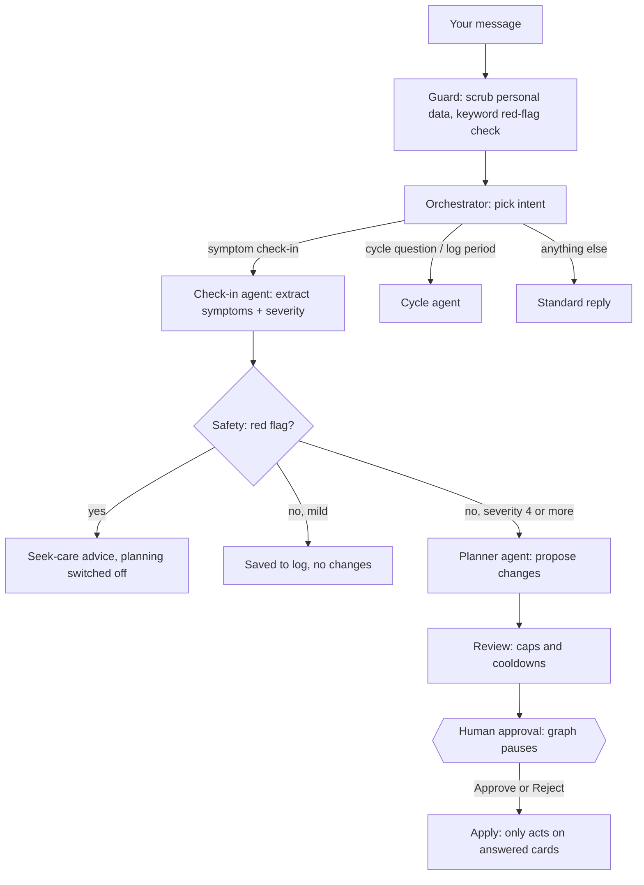

# Cyncle

**A period-aware productivity assistant that adapts your workload to your cycle, and only changes your plans with your approval.**

Cyncle combines cycle tracking, daily check-ins and task planning. You tell it how you feel in plain English, Nigerian Pidgin, or by voice. When symptoms are strong enough to affect your day, it suggests moving or cancelling specific tasks. You decide on every suggestion. Nothing changes until you approve it.

**Live demo:** https://cyncle.onrender.com
*(Hosted on a free tier: the first load can take a while, and demo data may reset after a quiet period or a redeploy.)*

> Built for the **Uzemi Agentathon 2026**, a 4-week programme for young women to learn Agentic AI and build practical solutions to real-world challenges.

---

## Table of contents

- [The problem](#the-problem)
- [Features](#features)
- [How it works](#how-it-works)
- [Safety and privacy by design](#safety-and-privacy-by-design)
- [Tech stack](#tech-stack)
- [Getting started](#getting-started)
- [Configuration](#configuration)
- [Deployment](#deployment)
- [API overview](#api-overview)
- [Project structure](#project-structure)
- [Trying it out](#trying-it-out)
- [Limitations](#limitations)
- [Disclaimer](#disclaimer)

---

## The problem

Energy, pain and focus change across the menstrual cycle, but most productivity tools assume every day is the same. People end up pushing through painful days, then falling behind and feeling guilty about it. Cycle trackers record symptoms but do nothing about the to-do list. Cyncle connects the two.

## Features

**Check-ins and planning**
- Describe how you feel in free text, in English or Nigerian Pidgin, or by voice.
- One-tap energy selector (Low, Okay, Great) that updates today's capacity estimate.
- Structured check-in with pain, energy and focus sliders.
- Suggestions to move or cancel tasks, each shown as a card you can **Approve**, **Skip** or **Reject**.
- Rejections are remembered: a task you reject is not proposed again for 7 days, and your reasons are stored to learn your preferences.

**Cycle tracking**
- Log the start of a period, and delete entries made by mistake.
- Set your typical cycle length as a range; Cyncle uses the midpoint to work out your phase.
- A cycle wheel showing day, phase (menstrual, follicular, ovulation, luteal) and the expected next period.
- Detects overdue periods and prompts you to log instead of warning you.

**Tasks and calendar**
- Today view with checkboxes, delete, a progress count, and an **Overdue** section (the first three, with "Show more").
- Week and calendar view for adding tasks for any day, with an importance level (High, Medium, Low). Low-importance tasks are moved first; High-importance tasks last.
- Export approved changes as an `.ics` file for any calendar app.

**Insights**
- How many suggestions you approved, symptom patterns by cycle day, and what Cyncle has learned from your rejections.

## How it works

Every message passes through a [LangGraph](https://langchain-ai.github.io/langgraph/) workflow. Language models are used to understand text and write replies. Safety checks, limits and every change to your tasks are handled in ordinary code.



| Stage | What it does |
|---|---|
| **Guard** | Removes phone numbers, emails and your name before text leaves the device, and runs a keyword red-flag check. |
| **Orchestrator** | Chooses one of four intents: symptom check-in, cycle question, log period, or other. |
| **Check-in agent** | Turns your message into symptom codes with severity (1 to 5) from a fixed symptom catalogue. |
| **Safety** | Checks symptoms against red-flag rules. If one fires, the graph never reaches the planner. |
| **Planner agent** | Proposes moving or cancelling tasks using a limited set of tools. |
| **Review** | Enforces caps: at most 3 proposals per check-in, 6 pending at a time, moves of at most 14 days, and a 7-day cooldown on rejected tasks. |
| **Approval** | The graph **pauses** (a LangGraph interrupt saved in SQLite) until you answer. Nothing is auto-approved. |
| **Apply** | The only step that changes tasks, and only for cards you answered. Unanswered cards stay pending. |

If no API key is set, or the model is unreachable, Cyncle falls back to **rule-based mode**, which uses keyword matching instead of the language models. It is less flexible, but the app keeps working.

## Safety and privacy by design

- **Human in the loop.** The assistant can only *propose* changes. Approval is required for every one.
- **Red-flag detection.** Warning signs, such as soaking through pads every hour, or fainting with bleeding, stop planning and show a "please get this checked" screen instead.
- **Limits in code, not in prompts.** Proposal caps, move limits and rejection cooldowns are enforced by the application, so the model cannot override them.
- **Data scrubbing.** Personal identifiers are stripped from text before it is sent to the model provider.
- **Per-browser data.** Each browser gets its own private database file, identified by a cookie.
- **Your data is yours.** A delete-my-data endpoint removes everything stored for a visitor.
- **Voice input** can be transcribed locally or with Groq's hosted Whisper model, selectable in Settings.
- **Not medical advice.** Cyncle gives planning suggestions only.

## Tech stack

| Layer | Technology |
|---|---|
| Backend | Python 3.12, FastAPI, Uvicorn |
| Agent orchestration | LangGraph with a SQLite checkpointer |
| Language models | Groq: `llama-3.3-70b-versatile` (check-in, planner, cycle) and `llama-3.1-8b-instant` (routing) |
| Speech to text | Groq `whisper-large-v3-turbo`, or local `faster-whisper` |
| Storage | SQLite (one database per visitor) |
| Frontend | Single-page vanilla HTML, CSS and JavaScript (`static/index.html`) |
| Deployment | Docker, Render |

## Getting started

### Prerequisites

- Python 3.12
- A [Groq API key](https://console.groq.com/) (optional: without it the app runs in rule-based mode)

### Run locally

```bash
# 1. Create and activate a virtual environment
python -m venv .venv
source .venv/bin/activate          # Windows PowerShell: .venv\Scripts\Activate.ps1

# 2. Install dependencies
pip install -r requirements.txt

# 3. Configure environment variables
cp .env.example .env               # Windows: copy .env.example .env
# open .env and set GROQ_API_KEY

# 4. Start the server
uvicorn server:app --reload
```

Open http://localhost:8000.

## Configuration

Set these in a `.env` file locally, or as environment variables on your host. Put only the value, with no inline comments, when entering them in a hosting dashboard.

| Variable | Description | Typical value |
|---|---|---|
| `GROQ_API_KEY` | Enables the language models and hosted speech-to-text. Leave unset for rule-based mode. | your key |
| `MULTI_USER` | `1` gives each browser its own private database (cookie-based). | `1` |
| `DEMO` | `1` wipes the shared default database on every start. Use `0` for real use. | `0` |
| `SEED_NEW` | `1` gives each new visitor sample data. Use `0` for real use. | `0` |
| `DATA_DIR` | Folder for per-visitor databases. Point it at a persistent disk in production. | `/data/visitors` |
| `CHECKPOINT_DB` | Path of the file that stores paused check-ins. Point it at a persistent disk in production. | `/data/checkpoints.db` |
| `PORT` | Port to listen on (set by most hosts). | `8000` |

Never commit your `.env` file. It is listed in `.gitignore`.

## Deployment

A `Dockerfile` is included:

```bash
docker build -t cyncle .
docker run -p 8000:8000 --env-file .env cyncle
```

**On Render:**

1. Create a **Web Service** from your repository, using the Dockerfile.
2. Add the environment variables from the table above under **Environment**.
3. Deploy.

**About data persistence.** Free hosting tiers use a temporary filesystem, so saved data is lost on every redeploy, restart or after the service sleeps. To keep user data, attach a persistent disk (for example mounted at `/data`) and set `DATA_DIR=/data/visitors` and `CHECKPOINT_DB=/data/checkpoints.db`. Alternatively, move storage to an external database.

## API overview

All endpoints are under `/api`.

| Method | Endpoint | Purpose |
|---|---|---|
| `POST` | `/chat` | Send a message to the assistant |
| `POST` | `/decide` | Submit approve or reject decisions for suggestions |
| `GET` | `/home` | Phase, tasks, pending suggestions and progress for Today |
| `GET` | `/week` | All active tasks for the calendar |
| `POST` | `/tasks` | Add a task |
| `POST` | `/tasks/done` | Mark a task done |
| `POST` | `/tasks/delete` | Delete a task |
| `GET` | `/cycle` | Cycle day, phase, history and expected next period |
| `POST` | `/cycle/range` | Save typical cycle length range |
| `POST` | `/period` | Log a period start |
| `POST` | `/period/delete` | Delete a logged period |
| `POST` | `/voice` | Transcribe a voice note |
| `GET` | `/insights` | Approval stats, patterns and rejection memory |
| `GET` | `/privacy` | Privacy settings and offline status |
| `POST` | `/privacy/stt` | Choose local or hosted speech-to-text |
| `POST` | `/delete` | Delete all of the visitor's data |
| `GET` | `/ics` | Download approved changes as a calendar file |

## Project structure

```
cyncle/
├── agent.py            # LangGraph workflow, agents, safety rules, database logic
├── server.py           # FastAPI app and API routes
├── static/
│   └── index.html      # Frontend (single page)
├── requirements.txt    # Python dependencies
├── Dockerfile          # Container build
├── .env.example        # Example configuration
└── README.md
```

## Trying it out

After setting up a period date on **Your cycle**, and adding a task due today or tomorrow, try these in the assistant:

| Message | What should happen |
|---|---|
| `I have bad cramps` | Symptoms are logged. |
| `I have terrible cramps and I'm very tired` | Strong symptoms: Cyncle suggests moving a task, and you can Approve, Skip or Reject. |
| `My belle dey pain me well well` | Pidgin is understood. |
| `When is my next period?` | Answers from your logged dates. |
| `My period just started` | Logs a period for today (delete it on **Your cycle** if you were testing). |
| `Hello` | Standard reply listing what Cyncle can help with. |

## Limitations

- Suggestions are based on logged symptoms and cycle phase. They are not a diagnosis.
- Cycle phase and capacity are estimates and work best with several logged periods.
- Without a persistent disk, data does not survive redeploys on free hosting.
- In rule-based mode (no API key, or the model is unreachable), only known keywords are understood.
- The interface is English only, although Nigerian Pidgin input is supported.

## Disclaimer

Cyncle is a planning tool and does **not** provide medical advice, diagnosis or treatment. If you have severe pain, very heavy bleeding, fainting or any other symptom that worries you, seek care from a qualified health professional.